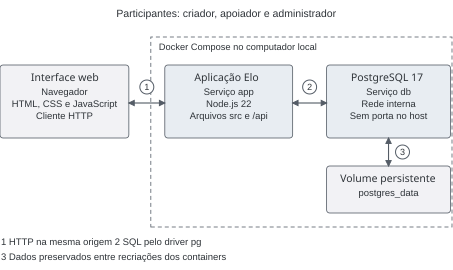
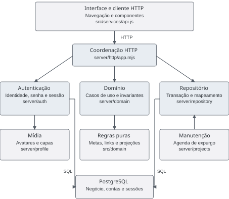
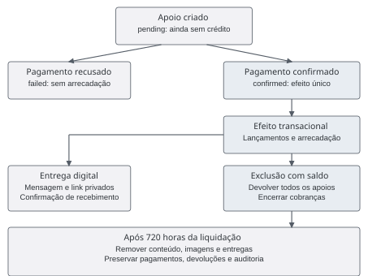

# Arquitetura da plataforma Elo

Financiamento coletivo e processo financeiro

Vitor Hugo Fernandes Costa

João Paulo Andrade Coelho

Disciplina: Arquitetura de Software
Franca - 2026

## 1 Problema e escopo do sistema

O Elo é um protótipo de plataforma de financiamento coletivo, inspirado nas jornadas de criação e apoio de projetos. Seu problema central é registrar contribuições e manter consistência entre pagamento, arrecadação, recompensa, repasse e devolução. Uma tentativa recusada não pode gerar receita; uma confirmação repetida não pode duplicar crédito; operações concorrentes não podem reutilizar o mesmo saldo.

O cenário escolhido no enunciado é uma plataforma de crowdfunding com foco no processo financeiro [R1]. O trabalho materializa uma proposta arquitetural e analisa coesão, acoplamento e conascência, relacionando as decisões aos compromissos de engenharia discutidos por Richards e Ford [R2]. A avaliação é demonstrada por código, diagramas, regras e testes, sem depender da escolha de uma tecnologia específica.

### 1.1 Participantes e limites de autorização

| Participante | Responsabilidades | Limites aplicados no servidor |
| --- | --- | --- |
| Apoiador | Descobrir projetos e criadores; apoiar; acompanhar pagamentos; receber recompensas; comentar e editar seu perfil. | Acessa os próprios apoios e entregas. Não publica campanhas nem consulta finanças privadas de terceiros. |
| Criador | Publicar e configurar seus projetos; oferecer recompensas e metas adicionais; publicar atualizações; entregar recompensas; consultar recebimentos e solicitar repasses simulados. | Pode apoiar outros projetos, mas não o próprio. Não configura projetos de terceiros e só recupera uma exclusão feita por ele mesmo. |
| Administrador | Excluir ou recuperar projetos; moderar comentários; punir contas; conversar com criadores e consultar logs. | Não cria campanhas, não edita perfis ou capas alheios e não recebe as mensagens e os links privados das entregas de recompensas. |

Suspensão permite leitura, mas bloqueia novas alterações, apoios e publicações. O cancelamento de uma assinatura existente continua permitido à conta suspensa, para impedir novas cobranças. Banimento bloqueia o acesso ao conteúdo da conta. As punições exigem motivo e podem ter prazo ou duração indeterminada.

### 1.2 Escopo implementado

O protótipo possui cadastro e login com senha, busca de projetos e criadores, categorias, favoritos, perfil com bio, links, foto e cidade/UF opcionais. Projetos aceitam capa própria, recompensas opcionais, atualizações, comentários e até dez metas adicionais. Criadores e apoiadores têm áreas próprias; a administração dispõe de painel com projetos, contas, comentários, mensagens e logs.

O processo financeiro contempla apoios pontuais ou mensais, simulação de confirmação ou recusa, cobrança de novos ciclos por solicitação manual, cancelamento, extrato, gráfico de recebimentos e repasses simulados. A compra de uma recompensa integra a arrecadação uma única vez. Entregas digitais são disponibilizadas por mensagem e link privado dentro do Elo.

A exclusão exige saldo para devolver integralmente os apoios registrados. Depois dos reembolsos, o conteúdo fica recuperável por trinta dias; após o prazo é removido, preservando referências e registros financeiros. A implementação é detalhada na seção 7.

### 1.3 Fronteira da demonstração

Cadastro, autenticação e persistência são implementados. Os pagamentos, os repasses e o catálogo inicial são simulados. Não são coletados dados de cartão, CPF ou conta bancária. O e-mail é um contato cadastrado, sem verificação de titularidade nesta versão.

Não há gateway, cobrança mensal automática, encerramento automático por meta ou prazo, entrega física, verificação de e-mail, recuperação de senha, MFA, redundância ou alta disponibilidade. O chat exige atualização da conversa; não utiliza WebSocket. A segurança implementada não representa certificação para operação financeira real.

## 2 Requisitos e prioridades arquiteturais

A prioridade é a integridade do processo financeiro, seguida de autorização, manutenção e reprodutibilidade. O enunciado solicita decisões justificadas e evidências de sua presença na solução [R1]. Assim, a arquitetura precisa explicar tanto os benefícios quanto os custos das escolhas adotadas.

| Qualidade | Decisão que a favorece | Consequência observável |
| --- | --- | --- |
| Consistência | Transação, bloqueio do agregado, idempotência e validação de vínculos. | Confirmar duas vezes não duplica crédito; falhas não deixam liquidação parcial. |
| Controle de acesso | Identidade da sessão, validação de papel e propriedade por recurso. | Ocultar um botão não é a única proteção; a API também rejeita a ação indevida. |
| Manutenibilidade | Apresentação, comunicação, autenticação, domínio e persistência identificáveis. | É possível localizar as responsabilidades e testar regras sem navegador ou banco. |
| Reprodutibilidade | Compose, migrações versionadas e geração local de segredos. | Outro integrante executa aplicação e banco sem receber as credenciais locais da equipe. |
| Compreensão | Temas neutros, navegação consistente e revisão de operações. | Valor, estado, recompensa e efeito financeiro aparecem de forma distinguível. |

Não foi assumida uma necessidade de escala distribuída. O bloqueio por workspace e a gravação do pequeno agregado foram escolhidos para facilitar consistência e demonstração. Essa decisão limita o paralelismo e deve ser revista antes de atender um volume elevado de usuários.

## 3 Visão geral da arquitetura

O estilo adotado é um monólito com modularização por responsabilidades e separação em camadas. Uma aplicação Node.js concentra os casos de uso e serve a interface. O PostgreSQL é um serviço de infraestrutura separado. Os módulos de negócio não possuem implantação independente; a existência de dois containers Docker não caracteriza microsserviços.

As visões abaixo usam a distinção do C4 entre unidades de execução e componentes internos [R3]. São representações adaptadas ao protótipo: um container lógico do C4 não se confunde necessariamente com um container Docker. A primeira figura explicita a implantação local; a segunda apresenta as dependências principais.



Figura 1 - Execução e implantação local. As setas representam HTTP, SQL e persistência no volume. Fonte: elaboração dos autores a partir de Dockerfile e compose.yaml.

O navegador carrega HTML, CSS e JavaScript da aplicação. Interface e API usam a mesma origem. No Compose, o banco fica na rede interna e não publica uma porta no host. A aplicação é vinculada a loopback; a porta padrão é 3000 e pode ser configurada. A instalação usada na verificação opera em localhost:3001.



Figura 2 - Componentes e dependências principais. As setas indicam uso; não representam cada consulta auxiliar. O núcleo de domínio não importa o driver pg. Fonte: elaboração dos autores a partir dos módulos do Elo.

O ponto de composição é server/index.mjs: cria o pool, o repositório, a autenticação, a limpeza periódica e o servidor HTTP. Dependências são fornecidas por parâmetros, como createApp com repository e authentication. O domínio recebe estado e relógio, e as regras podem ser exercitadas sem conexão externa.

A interface chama GET /api/state para obter uma projeção autorizada e POST /api/commands para executar casos de uso. Autenticação, avatares e capas têm rotas específicas. Trata-se de uma API HTTP orientada a comandos; não é descrita como REST completa. As contas autenticadas compartilham uma plataforma. O adaptador de personas permanece apenas em testes legados.

## 4 Módulos e análise de coesão

Coesão é a relação entre os elementos de um módulo e a finalidade que eles atendem. No Elo, uma divisão é adequada quando seus componentes colaboram para uma responsabilidade reconhecível, em vez de reunir funções somente por conveniência técnica. Os casos de uso financeiros permanecem próximos porque precisam preservar as mesmas invariantes.

| Módulo | Implementação principal | Responsabilidade e evidência de coesão |
| --- | --- | --- |
| Apresentação | src/app.js; src/components; estilos e tema | Navegação, entrada e apresentação. Componentes próprios renderizam projeto, modal, gráfico, metas e entregas. |
| Cliente HTTP | src/services/api.js | Comunicação, cookie, CSRF, fila de comandos e adoção da resposta da API. Não calcula o saldo de negócio. |
| Identidade | server/auth | Cadastro, senha, sessão, revogação e associação da conta à plataforma. |
| Imagens | server/profile | Validar, decodificar, normalizar e armazenar imagens com autorização e limites. |
| Regras de negócio | server/domain/platform.js | Campanhas, contribuições, recorrência, repasses, devoluções, comunidade e moderação. |
| Regras compartilhadas | src/domain | Normalização de metas, localização e entregas; projeções de relatório, busca e exportação. |
| Persistência | server/repository/postgres.js; server/db | Mapeamento SQL, transação, bloqueio, integridade e migrações. |
| Manutenção | server/projects/cleanup.mjs | Identificar conteúdo vencido e executar sua remoção transacional, sem comando público de expurgo. |

### 4.1 Exemplos concretos de coesão funcional

No processamento de imagens, limite de bytes, assinatura, decodificação, dimensões e regravação contribuem para uma mesma finalidade: produzir uma imagem aceita e normalizada. O componente não confirma pagamentos nem decide repasses. Separar esse processamento evita levar preocupações de formato de arquivo para a regra financeira.

No relatório de arrecadação, seleção de recebimentos, filtro de projeto, calendário de São Paulo, agregação e apresentação contribuem para uma visão de leitura. O módulo não confirma apoios nem altera a carteira. Alterar a aparência do gráfico não exige reescrever a liquidação.

Na entrega digital, elegibilidade, normalização do link e confirmação de recebimento têm uma finalidade comum. A mesma regra de URL é reutilizada na validação e na apresentação. No modal, título e subtítulo são tratados como texto em um componente único, reduzindo escapes repetidos e divergentes entre chamadores.

### 4.2 Limites reconhecidos

O núcleo de domínio ainda reúne diversos subdomínios em um arquivo e utiliza um estado comum. src/app.js também concentra coordenação de várias telas. A organização tem fronteiras lógicas, mas não elimina o risco de concentração de responsabilidades. Não seria correto apresentar cada caso de uso como um módulo completamente independente.

Uma evolução pode extrair financeiro, campanhas e comunidade por contratos explícitos, mantendo a transação que os coordena. A revisão final privilegiou correções localizadas e remoção de código sem uso; uma divisão ampla nesta etapa aumentaria o risco de regressão sem benefício demonstrado para a entrega acadêmica.

## 5 Acoplamento e comunicação entre componentes

Acoplamento expressa as dependências entre partes do sistema. A estratégia é tornar os acordos explícitos e conter os efeitos de mudança. Não é necessário eliminar uma dependência legítima: uma contribuição precisa se relacionar a um projeto, um apoiador e um criador existentes.

| Dependência | Comunicação e necessidade | Contenção e custo de mudança |
| --- | --- | --- |
| Tela para cliente HTTP | Chamadas do adaptador de API com dados de formulário. | Endpoints e CSRF ficam centralizados; a tela não conhece tabelas SQL. |
| Navegador para servidor | HTTP, JSON, cookie e uploads autenticados. | Contrato nomeado e erros explícitos. Alterar campos ainda exige coordenar cliente, servidor e testes. |
| HTTP para identidade e domínio | Resolução da sessão e chamadas dos casos de uso. | A identidade vem do servidor; permissões não dependem de parâmetros de papel enviados pela tela. |
| Coordenação para repositório | read e transact; callback de domínio dentro da transação. | Detalhes do bloqueio e da gravação ficam no repositório. O núcleo não importa pg. |
| Persistência para PostgreSQL | Driver, consultas parametrizadas, tabelas e constraints. | SQL concentrado, mas trocar de banco ainda exige adaptar esquema, consultas e testes. |
| Limpeza para domínio e repositório | Consulta de vencimento e transação por workspace. | Rotina interna reutiliza a regra de expurgo e não fornece uma API destrutiva ao navegador. |

O fluxo de comandos é síncrono: a interface envia, aguarda a resposta e atualiza a visão. Confirmação e devolução precisam manter contribuição, campanha e lançamentos consistentes no mesmo limite transacional. Filas distribuídas introduziriam mensagens repetidas, reordenação e consistência eventual sem necessidade comprovada no escopo atual.

A composição por parâmetros reduz o acoplamento ao mecanismo concreto durante os testes. Entretanto, autenticação e mídia ainda consultam o PostgreSQL em suas próprias fronteiras, e o repositório conhece a forma do agregado. Essas dependências foram reconhecidas, não ocultadas sob a ideia de independência total.

Há validações legítimas em mais de uma camada: formulário orienta o usuário; domínio protege regras; SQL protege dados persistidos. Repetir uma proteção em fronteiras diferentes não equivale automaticamente a redundância indevida. Já duplicar a mesma interpretação de um link ou escapar o mesmo subtítulo em vários chamadores favorece divergências; esses pontos foram centralizados na revisão.

## 6 Análise de conascência

Conascência identifica propriedades sobre as quais elementos precisam concordar para continuar funcionando juntos [R4]. A análise complementa o mapa de dependências, indicando o que uma alteração exige modificar. A seguir são apresentados cinco exemplos classificados, com tratamento e impacto de manutenção, acima do mínimo de três solicitado pelo enunciado.

### 6.1 Conascência de nome

Cliente, comando HTTP e createContribution concordam sobre nomes como campaignId, amountCents e rewardId. Renomear um deles somente no cliente faz a regra receber um campo ausente ou incorreto.

Tratamento: mantida como contrato explícito. O adaptador centraliza chamadas, o servidor seleciona os campos aceitos e testes de integração exercitam os nomes. O impacto de mudança envolve adaptador, dispatch e caso de uso, não as tabelas diretamente. Eliminar esse acordo tornaria a comunicação impossível; sua dispersão é que deve ser reduzida.

### 6.2 Conascência de tipo

Os valores financeiros são números inteiros de centavos, não strings monetárias nem ponto flutuante em reais. Por exemplo, R$ 25,00 corresponde a amountCents igual a 2500. Interface, validação de negócio, mapeamento do driver e colunas BIGINT precisam preservar essa representação.

Tratamento: mantida, com validação de inteiro seguro, limites e conversão explícita. A formatação em reais ocorre na apresentação. Uma mudança para outro tipo numérico exigiria rever validação, agregações, JSON e banco; alterar apenas a máscara visual não altera o tipo do domínio.

### 6.3 Conascência de convenção ou significado

pending significa pagamento não confirmado; confirmed, confirmação; failed, recusa. O significado determina o que pode gerar receita ou direito a uma recompensa. A devolução usa refundStatus separado: o pagamento original continua confirmado e o estorno aparece por metadados e lançamentos próprios.

Tratamento: mantida e explicitada em estados, transições e constraints. A interface distingue referência da tentativa de referência do pagamento; o código SIM identifica a operação mesmo em recusa. Acrescentar um estado exige coordenar domínio, persistência, histórico, relatório e apresentação. Um rótulo de tela isolado não modifica a regra financeira.

### 6.4 Conascência de posição

simulatePayment(id, outcome) exige que os chamadores preservem a posição dos argumentos. O primeiro identifica o apoio; o segundo informa o resultado. Inverter os valores compromete a chamada, mesmo que ambos sejam strings.

Tratamento: mantida nas chamadas JavaScript da interface e do domínio; reduzida no contrato HTTP, que usa campos nomeados id e outcome. O dispatch traduz o objeto em uma chamada posicional. Alterar essa assinatura exige ajustar chamadores da interface, adaptador, dispatch e testes. Uma futura assinatura com objeto nomeado reduziria o acordo posicional também nessas chamadas.

### 6.5 Conascência de execução

A mutação persistida depende da ordem: BEGIN, bloqueio do workspace, leitura, validação e regra, gravação, COMMIT. Um pagamento precisa existir e estar em transição permitida antes de produzir os lançamentos. Adquirir o bloqueio depois de calcular o saldo permitiria que dois pedidos usassem a mesma disponibilidade.

Tratamento: mantida dentro de uma fronteira transacional e concentrada no repositório. Falhas usam ROLLBACK; repetição usa idempotência. O PostgreSQL fornece os mecanismos de bloqueio e transação utilizados [R5]. Idempotência não é, por si só, um tipo de conascência: ela é uma estratégia para preservar o efeito único dentro desses acordos.

### 6.6 Força, grau e localidade

Nome, tipo e significado são acordos estáticos visíveis nos contratos. O acordo dinâmico de execução tem maior impacto potencial sobre a integridade financeira e deve permanecer próximo da regra que exige a sequência. Quanto mais módulos interpretam um estado, maior o grau de coordenação necessário; quanto mais espalhada a mudança, maior seu custo [R4].

A estratégia não promete eliminar toda conascência. Busca conservar acordos necessários, substituir convenções implícitas por contratos claros e localizar dependências fortes. Não se atribui conascência temporal somente porque existe uma data: a agenda de expurgo é uma regra de negócio; a ordem transacional é o exemplo de execução analisado aqui.

## 7 Processo financeiro, recompensas e dados

### 7.1 Do apoio ao efeito financeiro

O apoiador escolhe projeto, valor, modalidade e recompensa opcional. Após a revisão, o comando inclui chave de idempotência. O servidor valida conta, propriedade, restrições, disponibilidade, valor e recompensa. O apoio nasce pending, sem crédito. A confirmação ou recusa é solicitada ao simulador em uma operação posterior.

Uma confirmação válida registra data, atualiza a arrecadação e cria lançamentos vinculados: saída do apoiador e entrada do criador. A simulação representa uma origem externa; não debita a carteira de arrecadação de um criador que apoia outra campanha. Repetir a confirmação não cria novo crédito. Reutilizar a chave com parâmetros diferentes é rejeitado.

| Passo do exemplo | Arrecadado pelo exemplo | Parcela com recompensa | Resultado |
| --- | --- | --- | --- |
| Criar apoio de R$ 100 com recompensa mínima de R$ 50 | R$ 0 | R$ 0 | Registro pendente; nenhum crédito. |
| Confirmar o apoio | R$ 100 | R$ 100 | O valor pago inteiro integra a parcela com recompensa. |
| Repetir a confirmação | R$ 100 | R$ 100 | Nenhum lançamento adicional. |
| Confirmar apoio direto de R$ 50 | R$ 150 | R$ 100 | Parcela direta de R$ 50; a recompensa não é somada novamente. |

Os números do exemplo começam em zero. Totais ilustrativos antigos do catálogo sem contribuição vinculada não geram recebimentos ou devoluções inventados. O gráfico soma lançamentos autorizados e mostra receita bruta, devoluções e líquido do período separadamente. Uma referência de tentativa recusada não indica crédito.



Figura 3 - Fluxo principal de pagamento, entrega e exclusão. É uma visão dos estados e efeitos relevantes, não de todas as transições de recorrência. Fonte: elaboração dos autores a partir das regras e dos testes.

### 7.2 Recorrência e repasse

Cada renovação mensal é uma cobrança própria, ligada ao apoio original e a um ciclo. Sua geração é manual e sua confirmação é independente. Cancelar a recorrência impede novos ciclos, invalida pendências futuras e conserva os pagamentos confirmados. Não existe agendamento automático de cobrança.

O saldo disponível pertence à conta do criador, compartilhado entre seus projetos. Um filtro de gráfico não cria uma carteira por campanha. O repasse exige saldo suficiente e é serializado com as demais alterações. Uma devolução recebida como apoiador não aumenta o saldo de arrecadação sacável do criador.

### 7.3 Metas adicionais e entrega digital

Um projeto pode ter até dez etapas, com valores únicos acima da meta principal, ordenados de forma crescente. Uma campanha de R$ 45 mil pode prever versão alpha em R$ 70 mil e modo cooperativo em R$ 80 mil. Os valores são totais cumulativos: chegar a R$ 70 mil não exige arrecadar R$ 45 mil mais R$ 70 mil. Atingir uma etapa não gera lançamento financeiro, repasse ou publicação automática de recurso.

O criador encontra Entregas de recompensas em Meu estúdio. Somente um apoio confirmado, com recompensa e sem devolução, permite disponibilizar mensagem e link HTTPS. O apoiador consulta em Meus apoios e pode confirmar o recebimento. Alterar a entrega aumenta sua versão e exige nova confirmação. Enviar novamente o mesmo conteúdo não cria outra entrega.

A API entrega esse conteúdo somente ao criador responsável e ao apoiador participante. O administrador não recebe os links privados. Mensagem e URL não são copiadas para o log. Exclusão ou reembolso revoga a consulta dentro do Elo. Um destino externo continua sob controle de quem o fornece; o protótipo não revoga um arquivo remoto já acessado e não baixa o conteúdo do link no servidor.

### 7.4 Exclusão, devolução e recuperação

Antes da exclusão, a prévia informa o total de apoios confirmados ainda não devolvidos, pendências, assinaturas e saldo disponível. Inclui recompensas e renovações. Se o saldo geral do criador não cobrir todas as devoluções, a operação é recusada sem efeitos parciais, mesmo quando solicitada pelo administrador.

A transação recalcula os valores sob bloqueio, gera um lote e dois lançamentos por devolução, cancela pendências, encerra assinaturas e retira o projeto da área pública. Os pagamentos e comprovantes originais são preservados. A repetição com a mesma chave mantém o primeiro resultado; uma nova decisão exige outra chave.

O prazo de recuperação é de 720 horas, equivalente a trinta dias, contado após a liquidação bem-sucedida. O criador recupera somente uma exclusão própria. A administração pode recuperar uma remoção administrativa antes do prazo. A autoria de uma moderação legada é preservada quando suas devoluções são liquidadas posteriormente, impedindo que o criador transforme a remoção em exclusão própria.

Recuperar a publicação não desfaz estornos, não reativa assinaturas nem devolve acesso a uma recompensa já reembolsada. O servidor recusa recuperação no término do prazo, mesmo antes do próximo ciclo de limpeza.

### 7.5 Remoção do conteúdo e preservação financeira

A rotina interna de limpeza roda na inicialização e a cada minuto. Após o vencimento, remove imagem, descrição, apresentação, metas, recompensas, publicações, comentários, entregas e favoritos vinculados. Conserva uma linha mínima de referência da campanha, os pagamentos, lançamentos, estornos e auditoria necessários ao histórico. Portanto, remoção de conteúdo não significa apagar os registros financeiros relacionados.

O processamento ocorre em transação e é idempotente. Dois processos concorrentes não removem o conteúdo duas vezes. Há um único evento de manutenção validado por projeto; ele pode ser acrescentado mesmo quando o limite de auditoria das ações comuns foi atingido, sem truncar o histórico. O prazo é uma duração absoluta de 720 horas, evitando divergência em conexões com horário de verão.

Projetos legados sem prazo explícito não são agendados automaticamente. Com o servidor parado, a remoção aguarda a retomada do processamento. A política descrita refere-se à base de execução; cópias privadas de backup exigem gestão própria de retenção.

### 7.6 Entidades e integridade persistida

| Grupo | Tabelas ou estrutura | Finalidade |
| --- | --- | --- |
| Identidade | auth_users; auth_sessions; platform_settings | Conta, hash de senha, sessão revogável e plataforma compartilhada. |
| Projetos e perfis | campaigns; creator_profiles; account_avatars; project_images | Autoria, apresentação, localização e imagens. Metas e recompensas usam JSONB. |
| Comunidade | project_updates; project_comments; direct_messages; account_moderations | Publicações, conversa administrativa, visibilidade e punições. |
| Apoios e entrega | contributions; reward_deliveries | Pagamento, recorrência, vínculo de recompensa, mensagem privada e recebimento. |
| Financeiro e controle | ledger_entries; payouts; idempotency_records; audit_events | Lançamentos, repasses, repetição reconhecida e trilha de operações. |
| Agregado | demo_workspaces; demo_users; favorites | Fronteira de bloqueio, participantes do estado e favoritos. |

Chaves estrangeiras, unicidade e CHECKs complementam as validações do domínio. O repositório usa SELECT FOR UPDATE no workspace, reconstrói o estado e grava o pequeno agregado na mesma conexão e transação. A leitura usa uma visão consistente. Migrações aplicadas são verificadas por checksum e não devem ser editadas; mudanças de esquema exigem nova migração.

## 8 Justificativas arquiteturais e compromissos

As decisões abaixo apresentam a escolha, a alternativa considerada e o custo aceito. A análise associa cada opção às necessidades do recorte, em vez de afirmar que uma tecnologia garante qualidade arquitetural por si só [R2].

| Decisão | Alternativa considerada | Justificativa e custo aceito |
| --- | --- | --- |
| Monólito com camadas e módulos | Microsserviços independentes | Simplifica transações e implantação acadêmica. Exige maior cuidado com concentração no núcleo e não oferece escala independente por módulo. |
| Backend e PostgreSQL | Estado financeiro somente no navegador | Permite persistência e autorização compartilhadas. Exige operação e backup de um banco. |
| HTTP síncrono | Filas e eventos distribuídos | Torna o resultado do comando observável e preserva consistência imediata. Não oferece processamento distribuído desacoplado. |
| Bloqueio por workspace | Bloqueios finos e atualizações incrementais | Facilita impedir reutilização de saldo. Serializa alterações e regrava mais linhas que o necessário em escala maior. |
| Simulador de pagamento | Gateway real | Permite demonstrar transições sem dados financeiros reais. Não comprova liquidação, reconciliação ou antifraude externos. |
| Imagens no PostgreSQL | Armazenamento de objetos | Reduz infraestrutura e permite gravação atômica com auditoria. Aumenta o banco e o tamanho dos backups. |
| Entrega por mensagem e link | Upload de arquivos e entrega física | Atende o protótipo sem coletar endereço ou hospedar arquivos. O destino externo não é controlado pelo Elo. |
| Remoção em duas etapas | Apagar imediatamente ou conservar tudo | Combina recuperação por trinta dias com retirada de conteúdo vencido. Exige agenda de manutenção e separação do histórico financeiro. |

Docker Compose descreve serviços, rede e volume [R6]. A escolha de uma aplicação e um banco atende à reprodução local e ao pedido de não acrescentar redundância nesta fase. Uma falha do banco interrompe o serviço; containers e volume persistente não oferecem alta disponibilidade nem substituem backup.

A revisão manteve validações em fronteiras distintas, mas centralizou normalização de links e renderização de títulos onde havia interpretações repetidas. Essa escolha melhora manutenção sem introduzir uma nova camada genérica para todos os formulários ou reestruturar o núcleo na reta final.

## 9 Segurança, interação e evolução

### 9.1 Controles implementados

O cadastro público aceita somente criador ou apoiador. Senhas de 12 a 128 caracteres usam scrypt com salt aleatório e parâmetros N=131072, r=8, p=1. Sessões opacas duram sete dias, são armazenadas por hash e podem ser revogadas. Cookie HttpOnly/SameSite Strict, rotação no login, logout, origem e CSRF protegem as operações. Armazenamento de senha e autenticação seguem responsabilidades separadas da autorização de recursos [R7].

Há limites de tentativa por IP e identidade, capacidade de cadastro conferida sob bloqueio e filas limitadas de trabalho para senha e imagens. O banco recebe consultas parametrizadas. A resposta da API filtra dados por participante: e-mails ficam com titular e administração; finanças, conversas e entregas têm seus próprios limites de acesso. A exportação pessoal não inclui hashes ou sessões de terceiros.

Capas aceitam JPEG, PNG ou WebP estáticos de até 5 MiB e 16 milhões de pixels. O servidor decodifica, recorta e regrava JPEG 1280 x 800, sem metadados e de até 1 MiB. Avatares aceitam até 2 MiB e usam saída 512 x 512. Não se confia apenas na extensão; SVG e animações são recusados. Limite, validação de conteúdo e autorização são preocupações também indicadas pela OWASP [R8].

Texto de usuário é escapado antes de compor HTML. O cabeçalho dos diálogos agora trata título e subtítulo como texto, em um componente único. Links públicos aceitam HTTP/HTTPS sem credenciais; entregas exigem HTTPS. Os limites de 500 e 1.000 caracteres são conferidos também depois da normalização do endereço. O servidor não busca o conteúdo dos links de entrega.

### 9.2 Decisões de interação humano-computador

A interface usa superfícies neutras e hierarquia comum nos temas claro e noturno. Projeto e financiamento ficam próximos; a barra distingue apoio direto de recompensa com legenda textual. Operações financeiras mostram revisão, estado e referência. O gráfico oferece consulta por teclado e tabela diária, sem depender somente da cor ou do ponteiro.

Meu perfil fica em Meu espaço; foto e localização são alteradas em Editar perfil. Configuração pertence ao projeto do próprio criador; punição pertence ao perfil; logs ficam no painel administrativo. Diálogos identificados, rótulos de formulário, foco em controles e feedback de erro orientam a navegação. Essas escolhas se relacionam a preocupações de teclado, foco e identificação de entradas das WCAG 2.2 [R9], sem declarar conformidade integral.

### 9.3 Limites e evolução

Publicação externa exige HTTPS com cookie Secure, política coerente de proxy, monitoramento e revisão operacional. Faltam verificação de e-mail, recuperação de conta, MFA e um ciclo completo de alteração de credenciais. Logs atuais não são imutáveis contra quem administra o banco. A limitação em memória também precisaria ser distribuída se houvesse várias instâncias.

Pagamentos reais exigiriam provedor adequado, notificações autenticadas, reconciliação, reserva por projeto e devolução externa com tratamento de falhas. Maior escala exigiria gravações incrementais, bloqueios mais específicos e separação progressiva dos subdomínios. A inspeção interna, os testes e a ausência de alertas em dependências não substituem avaliação externa de segurança, acessibilidade ou usabilidade com participantes.

## 10 Evidências e correspondência com o enunciado

### 10.1 Verificação da versão entregue

Na rodada de 25 de novembro de 2026, npm test produziu 270 resultados: 269 aprovados, zero falhas e um skip da suíte opt-in de PostgreSQL real. A suíte de servidor é executada separadamente no Docker, com nove cenários e conexões físicas distintas; o TAP conta dez resultados incluindo o teste pai. O build verificou 32 entradas e sete recursos locais. A configuração Compose também foi verificada. Os registros estão em docs/VERIFICACAO.md.

| Evidência | Arquivos principais | Comportamento exercitado |
| --- | --- | --- |
| Regras e consistência | platform.test.mjs; project-features.test.mjs; project-refunds.test.mjs | Valores, transições, recorrência, reembolso, saldo insuficiente e efeito único. |
| API e identidade | authentication.test.mjs; integration.test.mjs; registration-quotas.test.mjs | Login, sessão, autorização, CSRF, isolamento e capacidade concorrente de cadastro. |
| Entregas e metas | creator-workflows.test.mjs; project-milestones.test.mjs; reward-deliveries-api.test.mjs | Metas cumulativas, privacidade, pagamento necessário, versão e revogação por reembolso. |
| Retenção | project-retention.test.mjs | Prazo, recuperação, conteúdo removido, auditoria cheia e horário de verão. |
| Concorrência real | postgres.test.mjs | Créditos, repasses, exclusões, entrega idempotente, expurgo concorrente e rollback. |
| Apresentação e mídia | modal-frame.test.mjs; project-detail.test.mjs; project-media-api.test.mjs | Escape de texto, controles por papel, criação com capa, limites e normalização. |
| Leitura financeira | revenue-report.test.mjs; support-history.test.mjs | Datas, filtro, devolução, valores históricos e ações compatíveis com o estado. |

Os nomes da tabela pertencem à pasta tests. PGlite exercita SQL e integração HTTP em processo local, mas seu adaptador serializado não comprova concorrência entre conexões físicas. Por isso, a evidência de disputa por bloqueio usa o PostgreSQL de servidor. Os cenários de teste possuem identificadores próprios e não substituem o banco do usuário.

A inspeção interativa anterior verificou criação e edição de metas, envio e recebimento de recompensa, recusa, reembolso e recuperação em uma cópia isolada. Os temas claro/noturno e formulários em tela estreita foram observados. A revisão final acrescentou regressões para o modal, permissões de criação e URLs Unicode. Esses ensaios não equivalem a pesquisa de usabilidade nem a certificação WCAG.

### 10.2 Revisão final de erros e redundâncias

Dois revisores independentes examinaram backend e interface; o coordenador integrou as correções e executou os testes. Fragmentos de HTML em títulos podiam quebrar a janela de entrega: a renderização do cabeçalho foi centralizada, removendo escapes repetidos nos chamadores. A criação por comando JSON admitia administrador, em divergência com o upload: as duas formas agora exigem criador.

URLs com caracteres Unicode podiam crescer ao serem normalizadas, ultrapassar o limite persistível e causar erro interno. Os limites agora são aplicados ao endereço final, com erro de validação antes de alterar o estado. A regra da entrega é compartilhada com sua apresentação. Também foram retiradas funções sem uso, um parâmetro não utilizado e a segunda lista de verificação redundante do build.

Não foram removidas proteções legítimas de autorização ou constraints SQL. Não foi feita uma refatoração estrutural do núcleo ou uma remoção indiscriminada de CSS legado. Os resultados representam a cobertura descrita, e não uma garantia de ausência de todo defeito.

### 10.3 Execução e roteiro de demonstração

O README e o guia Windows explicam a execução na pasta que contém compose.yaml. Docker Desktop precisa estar iniciado; Node.js 22.9 ou superior é usado para gerar configuração local. O comando de configuração não imprime segredos nem sobrescreve um arquivo existente.

```sh
node scripts/setup-env.mjs
docker compose up -d --build
```

Uma instalação nova abre em localhost:3000; se PORT for alterada para 3001, usa localhost:3001. O administrador fixo é gerado pelo procedimento privado do README; não existe senha administrativa compartilhada no pacote. O professor ou colega deve executar sua própria instalação. Um endereço localhost não é acesso remoto ao computador da equipe.

Roteiro sugerido: cadastrar criador e apoiador; criar projeto com recompensa e metas de R$ 45 mil, R$ 70 mil e R$ 80 mil; criar apoio pendente; confirmar e observar arrecadação e extrato; disponibilizar e receber uma entrega; testar a recusa de outro apoio; excluir com reembolso; recuperar o conteúdo e verificar que o dinheiro não foi recreditado. A rotina de trinta dias é demonstrada pelos testes de relógio e persistência, sem alterar datas do banco em uso.

```powershell
npm ci --ignore-scripts
npm test
npm run build
npm run check:compose
docker compose exec -T -e ELO_RUN_POSTGRES_TESTS=1 app `
  node --test tests/postgres.test.mjs
```

### 10.4 Matriz de atendimento documental

| Exigência do enunciado | Local nesta documentação | Evidência na solução |
| --- | --- | --- |
| Descrição do problema | Seções 1 e 2 | Escopo, participantes, restrições e prioridades. |
| Diagrama da arquitetura | Seção 3; figuras 1 e 2 | Execução local, componentes, tecnologias e dependências. |
| Identificação dos módulos | Seção 4 | Responsabilidades, arquivos e limites reconhecidos. |
| Análise de coesão | Seção 4 | Exemplos funcionais e concentração residual no núcleo. |
| Análise de acoplamento | Seção 5 | Comunicação, mapa de dependências e estratégias de contenção. |
| Pelo menos três conascências | Seção 6 | Cinco exemplos classificados, tratamento e impacto de evolução. |
| Justificativas arquiteturais | Seções 7 e 8 | Processo financeiro, alternativas e custos aceitos. |
| Evidência e evolução | Seções 9 e 10 | Limitações, testes, revisão e roteiro observável no protótipo. |

[R9] W3C. Web Content Accessibility Guidelines (WCAG) 2.2. Recomendação de 12 de dezembro de 2024. Disponível em: https://www.w3.org/TR/WCAG22/

Referências online verificadas em 25 de novembro de 2026. A classificação dos exemplos, as justificativas, os diagramas e as evidências foram elaborados a partir do código e das verificações do Elo. A obra indicada fundamenta a abordagem; não são atribuídas ao livro medições ou resultados obtidos nos testes do protótipo.
